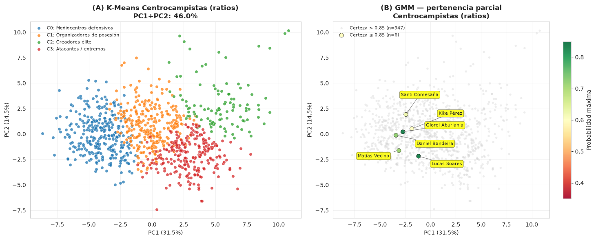
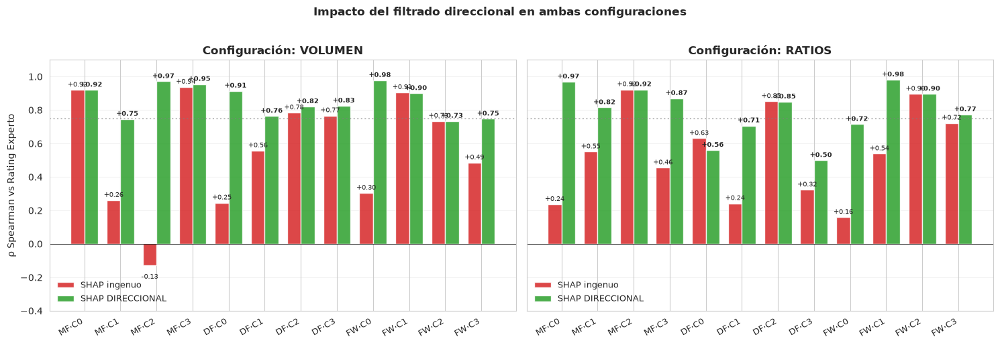
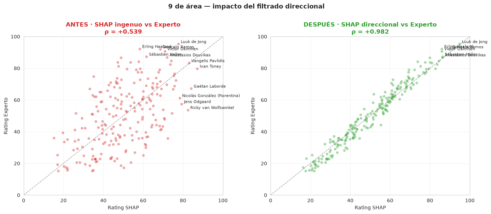
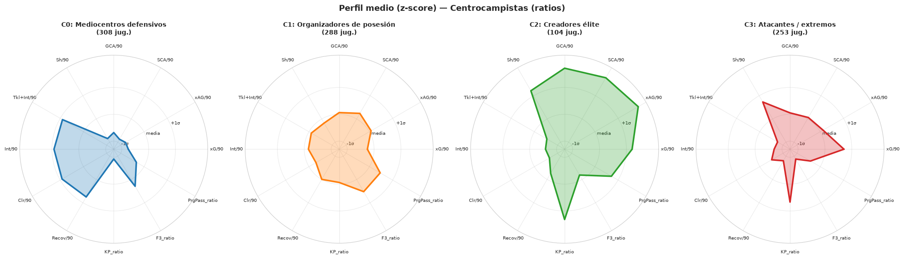

# Football Player Scouting: Segmentation, Explainable Ratings and Transfer Recommendation

An end-to-end scouting pipeline that groups players into tactical roles, rates them within their role using a new **directional SHAP** method, and recommends transfer targets. Built on FBref data for **2,153 outfield players across seven European leagues (2022/23)**.

> Bachelor's thesis (TFG) in Mathematics and Data Science, Universidad Complutense de Madrid, 2026. Grade: **9.5 / 10**.
> Supervisor: Juan Tinguaro Rodríguez González.
>
> 📄 **[Read the full thesis](docs/TFG_Mosquera_Taboada_2026.pdf)** (Spanish, 57 pages, English abstract).



## The problem

Raw per-90 statistics compare players who do very different jobs. A defensive midfielder with few shots isn't a bad player; shooting just isn't his job. Useful scouting needs three things:

1. **What role does a player actually play?** We infer it from the data, not from the listed position.
2. **How good is he at that role?** The rating must be explainable, not a black box.
3. **Who else plays the role in a similar way?** That gives the shortlist of replacements.

## Approach

| Stage | Method |
|---|---|
| **1. Segmentation** | K-Means, GMM and Fuzzy C-Means per line (DF / MF / FW), with **K = 4** roles each. K is justified with internal indices (Silhouette, Calinski–Harabasz, Davies–Bouldin, tail ratios) and **bootstrap stability (ARI)**. Two feature sets run in parallel: *volume* (per-90 stats) and *ratios* (efficiency metrics less biased by team style). |
| **2. Rating** | A Random Forest learns the roles and SHAP explains them. The rating is a SHAP-weighted percentile score within each role. Five variants are compared: naive SHAP, **directional SHAP**, expert weights, hybrid and hierarchical (line core + role-specific). |
| **3. Recommendation** | Weighted Euclidean distance using the directional SHAP weights of the target player's role, with filters for age, league and club. |
| **4. Validation** | Internal: agreement with expert criteria. External: correlation with Transfermarkt market values, with regression controls for age, age² and big-club premium. Predictive: ratings of the 2022/23 winter transfers, using **only** their pre-transfer data. |

### Key contribution: directional SHAP

Standard SHAP importance measures *how much* a feature separates a role, not *in which direction*. Some roles are defined partly by an **absence**: target men don't dribble and defensive midfielders rarely shoot. A naive SHAP rating therefore *rewards* a defensive midfielder for not shooting, and can even invert the ranking.

The directional filter keeps only the features whose SHAP contribution correlates **positively** with the feature value, i.e. those that define the role by presence. Only those features go into the rating.



## Results

- **Agreement with expert criteria improves in 17 of 24 roles** and stays equal in 4. The 3 drops are all marginal (< 0.07). Mean Spearman ρ rises from **0.55 to 0.83**. The biggest gains are in roles defined partly by absence. Example: attacking midfielders (volume) go from ρ = −0.13 to **0.97**.

  

- **Predictive validation on winter transfers.** Rated using only their data *before* moving, the top of the list is made of players who were signed by bigger clubs:

  | Player | From → To | Pre-transfer rating |
  |---|---|---|
  | Cody Gakpo | PSV → Liverpool | **94.1** |
  | Pedro Porro | Sporting CP → Tottenham | **88.2** |
  | Enzo Fernández | Benfica → Chelsea | **73.0** |

- **Market value.** The correlation is moderate where performance is directly measurable: target men ρ = 0.37 and ball-playing centre-backs ρ = 0.35. It is close to zero for full-backs, as expected, since their market value depends on things these stats don't capture. A regression on residuals controls for age and club. It then flags undervalued and overvalued players.

- **Recommender example: a young Busquets replacement.** The query asks for players aged ≤ 25 who are not at Barcelona. It returns Mats Wieffer, **Martín Zubimendi** and Ibrahim Sangaré.

<p align="center">
  
</p>

## Repository structure

```
├── notebooks/
│   └── player_scouting_pipeline.ipynb   # full pipeline, executed (in Spanish)
├── results/                             # ratings and cluster assignments per line and feature set
├── figures/                             # key figures
├── docs/                                # thesis (PDF)
├── data/                                # input data, not included (see data/README.md)
└── pyproject.toml                       # pinned dependencies
```

The notebook is written in Spanish, the language of the thesis. It is executed end to end, so all tables and figures can be read directly on GitHub.

## Reproducing the results

Requires [uv](https://docs.astral.sh/uv/).

```bash
git clone https://github.com/alvaromtaboada/football-player-scouting.git
cd football-player-scouting
uv sync
# put the input files in data/ (see data/README.md)
uv run jupyter lab notebooks/player_scouting_pipeline.ipynb
```

Dependencies are pinned (scikit-learn 1.6.1, SHAP 0.48.0, NumPy 2.0.2, pandas 2.2.2), so the results match the thesis exactly. Every stochastic step uses a fixed seed. A full run takes about 7 minutes on a laptop.

The notebook also runs on Google Colab: upload the files from `data/` to the session.

## Tech stack

Python · pandas · scikit-learn · SHAP · UMAP · t-SNE · matplotlib · seaborn

## Author

**Álvaro Mosquera Taboada**, BSc Mathematics and Data Science (UCM). Now studying an MSc in Big Data and Sports Data Analysis at Universidad Europea / Escuela Universitaria Real Madrid.

## License

Code released under the [MIT License](LICENSE). Input data belong to their respective providers.
